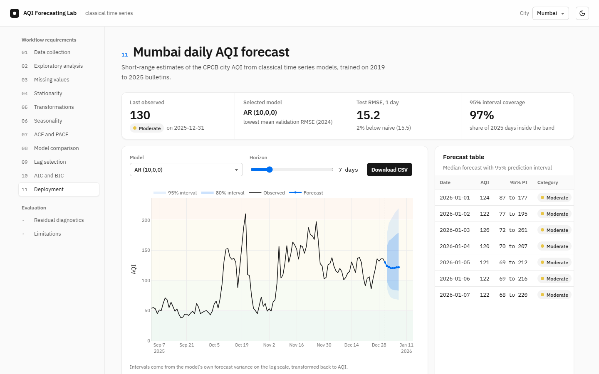

# AQI Forecasting Lab

Daily air quality forecasts for Mumbai and Delhi, built with classical time series models and shown in a dashboard you run on your own laptop.

This started as an Applied Time Series Analysis course project. The brief had 11 required steps, from data collection to deployment, and the dashboard walks through every one of them with the real numbers.



> Forecasts here are statistical estimates for study. They are not official CPCB forecasts or health advice.

A full guide to every chart and number, with the course requirement checklist, is in [docs/Project-Overview.pdf](docs/Project-Overview.pdf).

## Run it

You need Python 3.11 or newer ([python.org/downloads](https://www.python.org/downloads/); on Windows, tick "Add python.exe to PATH" in the installer).

1. Download the project: the green **Code** button on GitHub, then **Download ZIP**, and unzip it. If you use git, clone it with the URL from that same button instead.
2. Start it.
   - **Windows:** double-click `run.bat`.
   - **macOS or Linux:** open a terminal in the folder and run `./run.sh`.

The first launch sets up a private Python environment and installs seven packages, which takes a minute or two. After that it opens http://localhost:8000 in your browser. Later launches take a few seconds. Close the terminal window (or press Ctrl+C) to stop it.

Trained models ship with the repo, so nothing gets retrained on first run. If port 8000 is busy, the launcher picks the next free one and prints the address.

## What you can do in the dashboard

- Pick Mumbai or Delhi, choose any of the nine models, and forecast 1 to 30 days ahead with 80% and 95% bands.
- Download the forecast as a CSV.
- Step through the course workflow: data source, EDA, missing values, ADF and KPSS tests, the log transform, seasonal decomposition, ACF and PACF, lag selection, AIC and BIC.
- Compare models on 2025 data that none of them saw during selection, including a Diebold-Mariano test against the naive forecast.
- Check residual diagnostics (Ljung-Box, Jarque-Bera, residual ACF, QQ plot) for any model.

It has light and dark themes and works on a phone.

## What we found

Delhi's AQI is very predictable from its own history. The best model (SARIMAX with annual Fourier terms) cut the 7-day RMSE from 65.1 to 46.2 AQI points, and the gain is significant (p < 0.0001).

Mumbai was harder. The models beat "tomorrow equals today" by about 5% at one day and 10% at seven days, but over a single test year that gain isn't statistically significant (best p = 0.07). Sudden swings, probably driven by weather, dominate there. Adding wind and rainfall data would be the obvious next step.

## The data

Daily city AQI from the Central Pollution Control Board's [national bulletins](https://cpcb.nic.in/AQI_Bulletin.php), as compiled by [UrbanEmissions.info](https://github.com/urbanemissionsinfo/AQI_bulletins). It covers 297 cities from May 2015 to December 2025. Mumbai's monitoring network went from one station to seven in 2019, so modelling for Mumbai starts that year (Delhi starts in 2018).

Models are chosen on 2019 to 2023, compared on 2024, and scored once on 2025. Every split is chronological, and no forecast uses data from after the day it was made.

## For developers

```bash
python -m venv .venv
.venv\Scripts\activate            # macOS/Linux: source .venv/bin/activate
pip install -r requirements-dev.txt
python run_pipeline.py            # retrain both cities, about 3 minutes each
python serve.py                   # start the dashboard
python -m pytest -q               # run the tests
```

The notebook `notebooks/aqi_time_series_analysis.ipynb` repeats the analysis with matplotlib figures. Rebuild it with `python notebooks/build_notebook.py`.

| Path | What it holds |
| --- | --- |
| `src/` | data loading, analysis, models, evaluation |
| `run_pipeline.py` | runs all 11 steps and writes `artifacts/<city>.json` |
| `app/` | FastAPI backend and the dashboard (HTML, CSS, JS, Plotly) |
| `serve.py`, `run.bat`, `run.sh` | launchers |
| `data/raw/` | the source CSV and where it came from |

## Troubleshooting

- **"Python 3.11 or newer is required"**: install Python from python.org, then run the launcher again.
- **Windows error mentioning "DLL load failed" or a path that is too long**: move the folder somewhere shorter, such as `C:\aqi`. The launcher already tries to avoid this for deep folders.
- **The browser didn't open**: go to the address printed in the terminal.

## License

Code: MIT. The dataset in `data/raw/` is GPL-3.0 and belongs to its authors; see `data/raw/SOURCE.md`.
